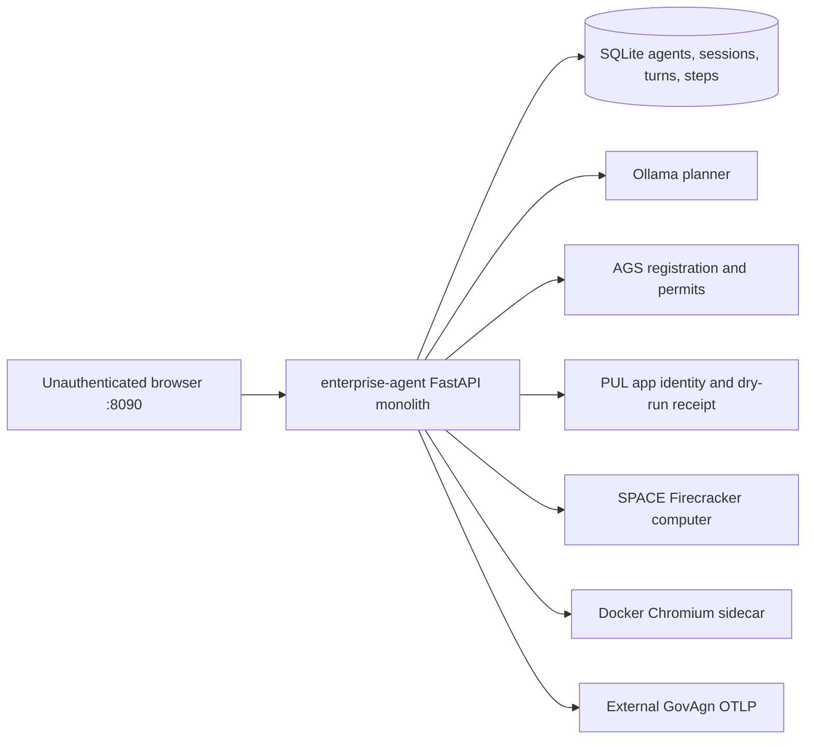
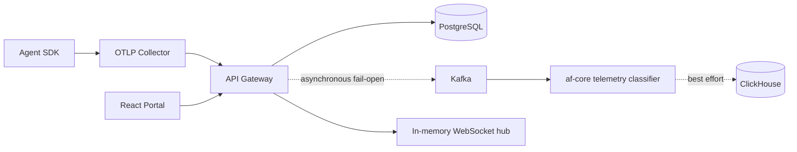
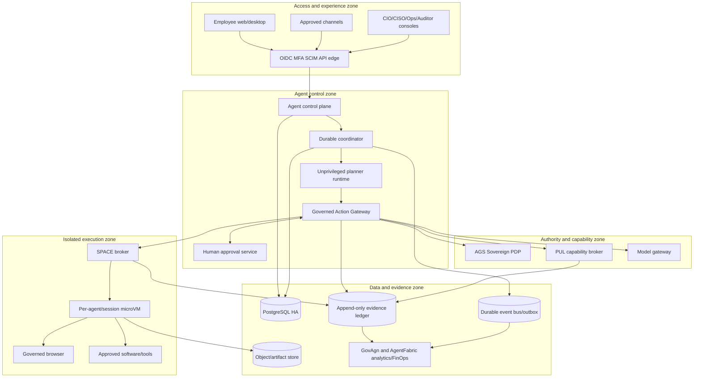

# Enterprise Agent Platform Architecture Review and Target Design

**Assessment date:** 24 October 2026  
**Status:** Architecture baseline for review; not a claim of production readiness  
**Scope:** AgentFabric, the local enterprise-agent vertical slice, AGS Sovereign,
PUL, SPACE, GovAgn, and lessons from Rakazo, OpenMausBot, OpenBot, Hermes Agent,
and REA.

What this repo does: AgentFabric currently combines an observability/FinOps
platform with a local proof of persistent AI teammates that can plan with a
local model, use a SPACE computer, call PUL, and emit evidence through GovAgn.
The review assumes the current local proof is a single-user development load;
no measured production concurrency or customer SLO is available, so the target
capacity model and sizing values below are design requirements, not benchmarks.

## Executive decision

AgentFabric has credible enterprise primitives, but they are not yet assembled
into one enforceable product boundary. There are two loosely connected systems:

1. An observability and FinOps path: SDK -> collector -> API gateway/PostgreSQL
   -> Kafka -> af-core/ClickHouse -> portal.
2. A computer-agent proof: inline FastAPI UI -> SQLite -> Ollama ->
   AGS/PUL/SPACE/Docker browser -> external GovAgn.

The second path bypasses the first path's identity, tenancy, portal, database,
budget, and API controls. It also lets one web process hold provisioning-grade
credentials, control Docker, call the model, execute browser actions, and serve
unauthenticated user APIs.

The recommended product is:

> A Hermes-class employee experience and Rakazo-class operability, using an
> OpenBot-class governed action flow, enforced by AGS/PUL/SPACE and evidenced
> by GovAgn and AgentFabric.

The governing responsibility split is deliberately simple:

- **AgentFabric controls** tenants, employees, teammates, teams, tasks,
  schedules, catalogues, quotas, budgets, and the product experience.
- **AGS Sovereign decides** whether a proposed action is allowed, denied,
  approval-required, or requires handoff.
- **PUL lends scoped application authority** and owns connection credentials,
  delegated identities, connector policy, and receipts.
- **SPACE executes** computers, browsers, files, software, and commands inside
  isolated, policy-constrained environments.
- **GovAgn proves and explains** what occurred through evidence projection,
  telemetry, risk, operations, and FinOps.

No model, skill, plugin, channel, or employee client may bypass that chain.

## 1. Scope, method, and confidence

The review used four architecture lenses:

- enterprise and product architecture;
- application, data, and integration architecture;
- security, trust-boundary, and evidence architecture;
- infrastructure, packaging, operations, and air-gap architecture.

The current repository was inspected at commit `4469dee` on branch
`review/space-computer-provider-g0-20261018`. Competitor conclusions are based
on primary repository sources at these revisions:

| Project | Revision reviewed | Role in this assessment |
|---|---:|---|
| Rakazo | [`85c16047`](https://github.com/elie222/rakazo/tree/85c16047d8def8f72d76963447ce6ac842d81bb4) | Server modularity, packaging, restricted-network delivery, upgrades |
| OpenMausBot | [`0a78caa9`](https://github.com/milind-soni/OpenMausBot/tree/0a78caa91a64c1ab1adfa972ab4e540e89b66c6d) | Employee UX, provider drivers, routines, desktop distribution |
| OpenBot | [`46642d6c`](https://github.com/CopilotKit/OpenBot/tree/46642d6c91daa663bccff673595f4e12a419a496) | Unavoidable action gateway, approvals, durable work, cluster packaging |
| Hermes Agent | [`bac34e9e`](https://github.com/NousResearch/hermes-agent/tree/bac34e9e9946c9c6a9ce7ce64efadd47f8fa375b) | Skills, memory, channels, schedules, delivery and lifecycle UX |
| REA | [`main`](https://github.com/morluto/rea) | Evidence contracts, local research tooling, installer/readiness patterns |

“REA” is assumed to mean **morluto/rea — Reverse Engineer Anything**, because
it is the strongest contextual match and explicitly integrates with agent
clients. REA is not a competing persistent-agent runtime. If another product
was intended, its repository must be supplied and assessed separately.

Confidence labels used in this document:

- **Implemented:** present in the active source path.
- **Locally demonstrated:** exercised on the development host; not a GA claim.
- **Contract tested:** verified with test doubles; not proof of a live service.
- **Proposed:** target architecture only.

## 2. Current architecture

### 2.1 Employee-agent flow



The runtime uses a hard-coded `enterprise-local` tenant, process-local locks,
synchronous HTTP turns, and an inline HTML/JavaScript interface. Browser
open/click/type operations go directly from the web process to Playwright.
The same process reads the AGS operator key, PUL admin token, SPACE local root
password, and GovAgn signing secret, and can execute Docker commands.

### 2.2 Existing observability and FinOps flow



The gateway persists spans before asynchronously publishing them. Active
`af-core` evaluates post-execution heuristics and writes an analytics projection
to ClickHouse. It is not the pre-execution authorization authority and cannot
block an agent action.

### 2.3 Current capability truth

| Capability | State | Architectural meaning |
|---|---|---|
| Named agents, instructions, local conversations | Implemented in the local runtime | Development proof, not tenant-safe |
| Local model planning | Implemented through direct Ollama calls | No model gateway or pre-use budget reservation |
| SPACE file/code execution | Locally demonstrated with Firecracker 1.15.1 | Strong foundation; local WSL network enforcement is incomplete |
| AGS launch/command decision adapter | Contract tested and locally demonstrated | Fail-closed adapter is reusable |
| PUL identity, deny/approval/receipt flow | Locally demonstrated in dry-run mode | No live connector proof |
| Dedicated browser | Implemented in Docker sidecars | Outside SPACE and outside the AGS action path |
| GovAgn trace correlation | Locally demonstrated | Not an externally immutable evidence ledger |
| Gateway OIDC/JWT/RBAC scaffolding | Implemented | Not used by the employee-agent runtime |
| Multi-tenant RLS | Partially modelled | Active hot tables do not have the claimed RLS boundary |
| Durable background tasks and schedules | Not implemented | Required before enterprise use |
| Signed offline release/upgrade/rollback | Not implemented | Required before air-gap product claims |

The recorded local proof remains useful and must be preserved as an integration
test. It must not be represented as independent GA acceptance, live connector
proof, or proof that all browser activity ran in Firecracker.

## 3. Assets to retain

### 3.1 Strict AGS, PUL, and SPACE adapters

The provider clients reject redirects, embedded credentials, and unsafe remote
plaintext origins; apply timeouts and size limits; distinguish management and
attachment credentials; require stable idempotency keys for mutations; and
model ambiguous outcomes conservatively. These are production-oriented
contracts and should move behind narrow brokers rather than be rewritten.

Evidence:

- [`integrations/space_provider/space_client.py`](../integrations/space_provider/space_client.py)
- [`integrations/space_provider/ags_authorizer.py`](../integrations/space_provider/ags_authorizer.py)
- [`integrations/space_provider/pul_client.py`](../integrations/space_provider/pul_client.py)

### 3.2 Mission state machine

`MissionBroker` records intent before network mutation, namespaces idempotency
by tenant/run/action, fails closed when policy is unavailable, and stops blind
replay after uncertain outcomes. This is the seed of the general task/action
saga, though SQLite is only suitable for the local profile.

### 3.3 Identity and operational UI scaffolding

The API gateway has useful OIDC, HttpOnly-cookie, JWT rotation, tenant context,
RBAC, rate-limiting, budget, and local-user scaffolding. The React portal has
trace, cost, audit, user, environment, and live-event surfaces. They should be
hardened and extended into employee/CIO/CISO views instead of replaced.

### 3.4 Telemetry and FinOps assets

The collector provides framework detection, server-owned enrichment, PII
scrubbing, cost attribution, batching, and operational metrics. PostgreSQL,
Kafka, ClickHouse, Prometheus, Grafana, and the agent SDK are useful telemetry
foundations. Compliance evidence must use a separate lossless path.

## 4. Architecture findings

### Must fix

#### 1. The agent proof bypasses enterprise identity and tenancy

**What this is:** The employee-facing runtime exposes agent, session, message,
browser, and artifact APIs without authentication and uses one fixed tenant.

**Problem:** Any reachable user can see or operate every local agent. The proof
cannot safely be made multi-user by exposing port 8090.

**Fix:** Move agent APIs behind the authenticated gateway/BFF; derive tenant,
employee, role, and entitlements from verified identity; persist ownership in
the canonical PostgreSQL model.

**If we skip it:** The product cannot meet enterprise confidentiality,
accountability, or separation-of-duty requirements.

#### 2. Self-service user update permits privilege escalation

**What this is:** `PUT /users/{userId}` allows role-or-self access while the
store update can modify role and activation state.

**Problem:** An ordinary user can update their own account to administrator.

**Fix:** Use separate self-service and administrative DTOs/routes. Identity,
role, group, tenant membership, status, and break-glass fields must be
administrator-only and audited.

**If we skip it:** A valid low-privilege account can take over the control
plane.

#### 3. Budget routes cross the tenant boundary

**What this is:** Budget handlers trust a URL `tenant_id` rather than enforcing
equality with the authenticated tenant.

**Problem:** A user who knows another tenant UUID can read its consumption and,
with tenant-admin rights, can alter its limits.

**Fix:** Use the JWT/workload tenant for tenant administrators. Model a separate
platform-admin authority for deliberately cross-tenant operations.

**If we skip it:** FinOps data and execution limits are not tenant-isolated.

#### 4. One process holds incompatible privileges

**What this is:** The planner/web process possesses AGS operator, PUL admin,
SPACE root, GovAgn signing, and Docker authority.

**Problem:** A prompt injection or web compromise becomes control-plane and
host compromise. There is no meaningful separation between proposal,
authorization, credential use, execution, and evidence.

**Fix:** Split the unprivileged planner from the action gateway and narrow
brokers. Use distinct workload identities and short-lived, action-bound
capabilities. Never scrape secrets from container environments.

**If we skip it:** AGS, PUL, SPACE, and GovAgn become advisory labels around a
privileged monolith rather than independent controls.

#### 5. Browser, model, and several tool paths bypass policy

**What this is:** Playwright and Ollama are called directly, while
`safe_browser_url` validates syntax but not private, loopback, link-local,
internal-service, redirect, or DNS-rebinding destinations.

**Problem:** An agent can use the browser or model route to perform reads or
effects that were never represented to AGS. Browser SSRF can target internal
services.

**Fix:** Send every sensitive read and effect through the canonical action
gateway. Resolve targets from trusted state, enforce network policy at SPACE,
re-evaluate redirects, and place the production browser inside the governed
execution plane.

**If we skip it:** “Every action is controlled” is false.

#### 6. Tenant identity at telemetry ingest is caller-controlled

**What this is:** The gateway accepts `X-AF-Tenant` from a collector sharing one
symmetric token; the current exporter does not set it and therefore collapses
traffic into the default tenant.

**Problem:** A compromised collector can submit data under another tenant, and
normal collectors lose original tenant attribution.

**Fix:** Authenticate workload identity with mTLS or signed service tokens and
derive permitted tenant scope from that identity. Bind individual span tenants
to an attested source and validate every batch.

**If we skip it:** Audit, cost, and policy telemetry can be forged or
misattributed.

#### 7. Active policy and audit behaviour contradicts documentation

**What this is:** Active `af-core` performs post-ingest heuristic classification
and best-effort ClickHouse writes. Hash-chain audit code described by existing
documents is in `_archive`, while the gateway reads a PostgreSQL audit table
that active `af-core` does not populate.

**Problem:** Documentation presents retrospective analytics as immutable
governance. Operators cannot know which component actually authorized or
recorded an action.

**Fix:** Make AGS the only execution PDP; rename the active af-core policy path
to telemetry/risk classification; define one authoritative action-evidence
ledger and retire or clearly quarantine archived implementations.

**If we skip it:** Compliance claims will not survive technical due diligence.

#### 8. Duplicate schemas do not enforce the claimed RLS boundary

**What this is:** Migration 001 creates UUID `agent_runs` and `span_metadata`
with RLS; migration 002 creates separate TEXT `runs` and `spans` used by the
gateway. The application does not set `app.tenant_id` for the RLS schema.

**Problem:** The tables that are actually queried rely on application filters,
not the documented database isolation boundary.

**Fix:** Choose one identifier type and one schema; migrate all access; enable
and force RLS; use a non-owner application role; set tenant context inside each
transaction; add cross-tenant negative tests.

**If we skip it:** A missing WHERE clause becomes a customer data breach.

#### 9. There is no canonical task/action/evidence identity chain

**What this is:** User, agent, AGS agent, PUL app, session, run, trace, sandbox,
process, receipt, approval, and decision IDs are produced independently.

**Problem:** An auditor cannot deterministically reconstruct employee ->
teammate -> task -> proposal -> decision -> approval -> execution -> result ->
cost.

**Fix:** Publish canonical contracts and correlation rules. Every subsystem may
retain a native ID, but it must reference the same tenant, actor, agent, task,
run, step, action, and evidence-chain IDs.

**If we skip it:** Evidence remains a collection of logs rather than a provable
business transaction.

#### 10. No durable coordinator exists

**What this is:** A turn executes synchronously in an HTTP request using
process-local locks and SQLite.

**Problem:** Restarts can strand work; there are no leases, checkpoints,
approval pause/resume, cancellation, retry budgets, dead letters, schedules,
or reliable delivery states.

**Fix:** Implement a PostgreSQL-backed coordinator with idempotent offers,
database-clock leases, `SKIP LOCKED`, checkpoints, transactional outbox,
reconciliation, and explicit terminal/ambiguous states.

**If we skip it:** Persistent teammates will be unreliable precisely when work
is long-running or needs human approval.

#### 11. Compliance evidence travels through lossy telemetry paths

**What this is:** Collector queues may drop, exporter failures clear batches,
Kafka publish is fire-and-forget, af-core auto-commits, and failed ClickHouse
batches are cleared.

**Problem:** Those choices are reasonable for low-latency dashboards but cannot
be the authoritative record of effectful actions.

**Fix:** Separate lossless action evidence from sampled/best-effort telemetry.
Commit state plus outbox atomically, use acknowledged delivery and DLQs, store
content hashes in append-only/WORM storage, and anchor evidence externally.

**If we skip it:** A healthy dashboard can coexist with missing compliance
evidence.

#### 12. Packaging is not one installable product

**What this is:** Root Compose, a second Compose profile, incomplete Helm
templates, a static Kubernetes manifest, pre-existing AGS/SPACE containers,
an external PUL package, an external GovAgn checkout, and startup-time package
downloads form separate delivery paths.

**Problem:** Versions, upgrades, secrets, compatibility, rollback, and support
cannot be managed as one release—especially without internet access.

**Fix:** Publish one signed compatibility BOM and offline bundle containing all
images, charts, migrations, clients, SPACE templates, approved software/model
artifacts, SBOMs, provenance, licences, tests, and rollback assets.

**If we skip it:** The platform remains an integration lab rather than a
supportable enterprise product.

### Should fix

#### 13. Action authorization does not bind executable content

**What this is:** Script execution fingerprints the interpreter and path, not
the immutable bytes subsequently executed.

**Problem:** Content at an approved path can change between decision and use.

**Fix:** Execute content-addressed artifacts and bind code, tool, image,
software, target, arguments, policy version, and environment digests into the
permit.

**If we skip it:** Approval of one script can authorize different code.

#### 14. Provisioning lacks a durable saga

**What this is:** AGS/PUL identities and SPACE computers are created before the
local database commit.

**Problem:** Failures and concurrent retries can orphan identities, computers,
and credentials.

**Fix:** Persist desired state first, use deterministic idempotency keys, and
let reconcilers converge create/update/delete operations with compensation.

**If we skip it:** Resource leaks and conflicting identities will accumulate.

#### 15. Budget enforcement occurs after consumption

**What this is:** Budget checks run when telemetry arrives and fail open on
errors.

**Problem:** Spend has already occurred, and concurrent consumers can race past
a hard limit.

**Fix:** Keep telemetry budgets for reporting, but add atomic reservation and
settlement before model/tool invocation, scoped by tenant, agent, task, model,
and capability.

**If we skip it:** “Hard budget” will mean alerting rather than prevention.

#### 16. Process-local state blocks horizontal scaling

**What this is:** Session locks, WebSocket clients, and budget-alert dedupe are
held in process memory; browser containers are local to the web process.

**Problem:** Replicas will disagree, duplicate work, or lose live updates.

**Fix:** Use shared leases and an event bus, sticky-free APIs, a fan-out service,
and schedulable execution brokers. Treat Redis as an optimization, not truth.

**If we skip it:** HA will produce inconsistent behaviour rather than
availability.

#### 17. Product concepts are overloaded

**What this is:** Gateway “agents” are names aggregated from telemetry while
the new runtime “agents” are employee-created teammates.

**Problem:** APIs, data models, dashboards, and ownership semantics will collide.

**Fix:** Use distinct domain terms: `AgentDefinition`, `AgentInstance`, `Task`,
`ExecutionRun`, `Action`, `EvidenceRecord`, and `TelemetryTrace`.

**If we skip it:** New features will deepen schema and API ambiguity.

#### 18. Pricing has multiple disagreeing sources

**What this is:** Collector constants and a dormant database table contain
different model prices.

**Problem:** Cost reports are not reproducible or explainable.

**Fix:** Create an effective-dated, signed price catalogue and record the price
version, currency, contract, and calculation inputs on every settled usage row.

**If we skip it:** FinOps totals can change depending on which component
calculated them.

### Nice to have

#### 19. Client APIs are hand-written and inconsistent

**What this is:** Some portal pages use shared authenticated hooks while others
issue direct fetch calls.

**Problem:** Authentication behaviour and error handling can diverge.

**Fix:** Generate clients from versioned OpenAPI contracts and centralize
credentials, correlation, retries, and error mapping.

**If we skip it:** UI defects will increase as the API surface grows.

#### 20. Historical architecture files look authoritative

**What this is:** `ARCHITECTURE_IMMUTABILITY.md` declares stale service and
audit assumptions “sacred” and “source of truth.”

**Problem:** Engineers may optimize for an obsolete topology or treat current
gaps as implemented controls.

**Fix:** Mark historical documents clearly, move accepted choices into ADRs,
and make this baseline plus approved ADRs the source of architectural truth.

**If we skip it:** Documentation drift will continue to create false assurance.

## 5. Lessons from open-source systems

### 5.1 Comparative scorecard

| Concern | AgentFabric today | Best external lesson | Target choice |
|---|---|---|---|
| Independent execution policy | Strong AGS concept, incomplete coverage | OpenBot’s unavoidable gateway and effect context | Keep AGS; adopt gateway semantics |
| Enterprise application authority | Strong PUL concept, dry-run proof | Rakazo/OpenMaus connection UX | Keep PUL; improve onboarding/catalogues |
| Execution isolation | SPACE Firecracker is strongest | OpenBot per-bot lifecycle; provider abstraction elsewhere | SPACE is canonical; Docker dev-only |
| Durable work | Missing in employee runtime | OpenBot lease queue + OpenMaus lifecycle | PostgreSQL coordinator with both patterns |
| User experience | Early local roster/chat | OpenMaus roster/routines; Hermes interruption/channels | One agent core across approved surfaces |
| Skills and memory | Roadmap | Hermes progressive disclosure and reviewed writes | Signed skills; classified, scoped memory |
| Packaging | Fragmented | Rakazo restricted network; OpenBot cluster; Hermes desktop | One signed offline enterprise bundle |
| Evidence | Many disconnected records | REA evidence/limitations discipline | Canonical lossless evidence ledger |
| Observability/FinOps | Major differentiator | Others provide narrower operations views | Keep and integrate GovAgn/AgentFabric |

### 5.2 Rakazo: adopt, adapt, reject

Adopt:

- ports-and-adapters package boundaries;
- separate API, worker, and sandbox supervisor;
- PostgreSQL application/migration roles and reconciliation workers;
- multi-architecture OCI images, SBOM/provenance, restricted-network install,
  backup, health-gated upgrade, and cached rollback;
- web, desktop, and mobile clients sharing server contracts.

Adapt:

- provider registries become CIO/CISO-approved signed catalogues;
- external connectors become PUL-managed application identities;
- generic secret backends integrate with the enterprise Vault/KMS/HSM;
- clients use internal enterprise distribution and update feeds.

Reject in the air-gap profile:

- moving tags, public updater dependencies, dynamic npm downloads, remote MCP
  chosen by employees, and external sandbox/model control planes.

Primary sources: [adapter interfaces](https://github.com/elie222/rakazo/blob/85c16047d8def8f72d76963447ce6ac842d81bb4/packages/adapter-kit/src/interfaces.ts),
[worker](https://github.com/elie222/rakazo/blob/85c16047d8def8f72d76963447ce6ac842d81bb4/apps/worker/src/index.ts),
[restricted-network deployment](https://github.com/elie222/rakazo/blob/85c16047d8def8f72d76963447ce6ac842d81bb4/docs/self-host-restricted-network.md),
and [self-hosting/upgrades](https://github.com/elie222/rakazo/blob/85c16047d8def8f72d76963447ce6ac842d81bb4/docs/self-host.md).

### 5.3 OpenMausBot: adopt, adapt, reject

Adopt:

- a small provider-driver SPI and canonical runtime event bus;
- unavailable-shadow providers and provider contract tests;
- explicit queued/running/waiting/needs-input/completed/failed/cancelled states;
- bot roster, task threads, interruption, routine calendar, progress, and
  diagnostics;
- per-bot browser profiles, DNS/redirect/egress checks, and process cleanup;
- signed desktop packaging and self-contained native dependencies.

Adapt:

- turn one-command online setup into `agentfabric install <signed-bundle>`;
- replace local JSON/SQLite/NDJSON with PostgreSQL, object storage, and GovAgn;
- use approved model services and workload identities instead of local
  subscription-bearing CLIs;
- keep Electron as a thin client without execution authority.

Reject:

- Full Access defaults, optional safety floors, loopback-as-owner trust,
  plaintext provider secrets, runtime downloads, native modes that bypass the
  action gateway, and a shared OS/container identity.

Primary sources: [provider contract](https://github.com/milind-soni/OpenMausBot/blob/0a78caa91a64c1ab1adfa972ab4e540e89b66c6d/server/contracts.ts),
[durable runtime contract](https://github.com/milind-soni/OpenMausBot/blob/0a78caa91a64c1ab1adfa972ab4e540e89b66c6d/docs/runtime-contract.md),
[self-hosting](https://github.com/milind-soni/OpenMausBot/blob/0a78caa91a64c1ab1adfa972ab4e540e89b66c6d/docs/self-hosting.md),
and [browser packaging](https://github.com/milind-soni/OpenMausBot/blob/0a78caa91a64c1ab1adfa972ab4e540e89b66c6d/docs/browser-packaging.md).

### 5.4 OpenBot: adopt, adapt, reject

Adopt:

- one unavoidable gateway for every computer or application effect;
- trusted server-side target resolution rather than model-supplied labels;
- effect-oriented policy context including person/routine/handoff initiator;
- deny precedence, fail-closed evaluation, shadow policy, and immutable floors;
- digest-bound, single-use approval followed by target and policy revalidation;
- PostgreSQL work leases, idempotent offers, database clock, `SKIP LOCKED`,
  bounded attempts, and retained failures;
- a tiny privileged supervisor with domain verbs, not generic Docker access;
- release manifests, image digests, migrations, HPA/PDB, NetworkPolicy, and
  provenance.

Adapt:

- compile typed enterprise policies into AGS rather than relying only on
  free-form CEL;
- use SPACE and PUL brokers in place of direct container/MCP execution;
- require internal identity and offline dependencies for the sovereign edition.

Reject:

- allow-all starter policy, model-based final authorization, proxy-only egress,
  Docker-socket authority in a broad service, and mandatory external
  intelligence/licensing endpoints.

Primary sources: [architecture](https://github.com/CopilotKit/OpenBot/blob/46642d6c91daa663bccff673595f4e12a419a496/docs/architecture.md),
[action gateway](https://github.com/CopilotKit/OpenBot/blob/46642d6c91daa663bccff673595f4e12a419a496/server/src/computer/gateway.ts),
[approval service](https://github.com/CopilotKit/OpenBot/blob/46642d6c91daa663bccff673595f4e12a419a496/server/src/approvals/service.ts),
and [work queue](https://github.com/CopilotKit/OpenBot/blob/46642d6c91daa663bccff673595f4e12a419a496/server/src/work/queue.ts).

### 5.5 Hermes Agent: adopt, adapt, reject

Adopt:

- one agent core exposed through CLI, desktop, web, messaging, API, IDE, cron,
  and batch adapters;
- versioned registries for models, tools, terminals, browsers, memory, context,
  channels, and MCP;
- progressive skill disclosure;
- cancellation, interruption, steering, queuing, background work, schedules,
  notifications, and explicit reason codes;
- delivery ledgers that preserve `unknown` after ambiguous sends;
- reviewed memory/skill writes, scheduler recovery scenarios, signed packages,
  corporate mirrors, and mixed-version detection.

Adapt:

- add tenant, owner, source, classification, purpose, retention, policy version,
  and approval provenance to memory;
- package plugins out of process with signed manifests and least privilege;
- run all execution through the same AgentFabric action contract.

Reject:

- YOLO/global approval-off, pattern matching as the security boundary,
  container-means-approved logic, terminal bypass of file guards, in-process
  untrusted plugins, broad secret forwarding, writable shared skills, and local
  filesystem state for enterprise HA.

Primary sources: [architecture](https://github.com/NousResearch/hermes-agent/blob/bac34e9e9946c9c6a9ce7ce64efadd47f8fa375b/website/docs/developer-guide/architecture.md),
[security](https://github.com/NousResearch/hermes-agent/blob/bac34e9e9946c9c6a9ce7ce64efadd47f8fa375b/website/docs/user-guide/security.md),
[cron internals](https://github.com/NousResearch/hermes-agent/blob/bac34e9e9946c9c6a9ce7ce64efadd47f8fa375b/website/docs/developer-guide/cron-internals.md),
and [messaging](https://github.com/NousResearch/hermes-agent/blob/bac34e9e9946c9c6a9ce7ce64efadd47f8fa375b/website/docs/user-guide/messaging/index.md).

### 5.6 REA: use as a research and evidence reference

REA's production value is not as an embedded agent runtime. Its useful lessons
are:

- one reviewed setup flow that registers tools with multiple agent clients;
- provider/readiness diagnostics and compact MCP schemas;
- bounded outputs and explicit coverage/truncation status;
- separation of observation from inference and preservation of unknowns;
- content-addressed evidence, snapshots, import/export, and local analysis;
- release comparison for authorized Electron, browser, package, and binary
  research.

Place REA only in a controlled architecture-research lab using a disposable
SPACE computer, dedicated profile, approved target artifacts, internal model,
and GovAgn research-evidence store. Do not make it a production dependency,
attach it to employee/production profiles, or use it to inspect software without
documented legal authority.

Primary sources: [README](https://github.com/morluto/rea/blob/main/README.md),
[MCP contracts](https://github.com/morluto/rea/blob/main/docs/mcp-contracts.md),
[installation](https://github.com/morluto/rea/blob/main/docs/installation.md), and
[responsible-use terms](https://github.com/morluto/rea/blob/main/DISCLAIMER.md).

## 6. Target reference architecture



### 6.1 Component boundaries

#### AgentFabric control plane

Owns organisations, tenants, employees, groups, agent definitions, teams,
templates, entitlements, approved catalogues, schedules, quotas, budgets, and
the product APIs. It never holds connector secrets, policy-authoring keys, or
direct Docker/KVM authority.

#### Durable coordinator

Owns tasks, leases, checkpoints, retries, cancellation, schedules, approval
waits, sagas, compensation, delivery state, and reconciliation. Notifications
are latency optimizations; PostgreSQL state is delivery truth.

#### Planner runtime

Owns conversation assembly, reasoning, memory retrieval, and typed action
proposals. It has no long-lived enterprise credentials and no route to
protected networks except through approved model and action gateways.

#### Governed Action Gateway

Owns validation, trusted target resolution, semantic effect classification,
data classification, decision/approval orchestration, idempotency, execution
dispatch, result redaction, and evidence correlation. It coordinates authority;
it does not define policy or hold business credentials.

#### AGS Sovereign

Is the authoritative PDP. It returns permit, deny, approval-required, or
handoff-required plus constraints, decision identity, policy digest, expiry,
nonce, and revocation reference. It executes nothing.

#### PUL

Owns enterprise app identities, delegated user authority, OAuth/token lifecycle,
credential vaulting, connector-specific policy, and signed receipts. Models and
planners receive results and receipt references, never provider secrets.

#### SPACE

Owns computer/browser/software-template lifecycle, resource/network isolation,
execution, snapshots, and cleanup. It accepts only short-lived capabilities
bound to an approved action digest. Isolation is not a substitute for
authorization.

#### Evidence service and GovAgn

The evidence service stores the authoritative append-only proposal, decision,
approval, execution, receipt, and artifact relationships. GovAgn indexes,
correlates, monitors, visualizes, and applies retention/export/reporting. GovAgn
must not authorize actions it later reports on.

## 7. Canonical contracts

### 7.1 Domain identifiers

Use opaque immutable IDs and always carry:

```text
organization_id -> tenant_id -> employee_id -> agent_definition_id
                -> agent_instance_id -> task_id -> run_id -> step_id
                -> action_id -> evidence_chain_id
```

Native AGS, PUL, SPACE, GovAgn, provider, sandbox, process, trace, approval, and
receipt IDs are cross-references, not replacements for canonical IDs.

### 7.2 Action envelope

Minimum fields:

```yaml
schema_version: af.action.v1
identity:
  organization_id: ...
  tenant_id: ...
  employee_id: ...
  agent_definition_id: ...
  agent_instance_id: ...
  initiator_type: person|schedule|webhook|delegate|operator
execution:
  task_id: ...
  run_id: ...
  step_id: ...
  action_id: ...
  idempotency_key: ...
action:
  capability_id: ...
  capability_version: ...
  effect: read|navigate|type|activate|write|execute|send|delete|administer
  target: trusted-normalized-target
  argument_digest: sha256:...
  content_digests: [sha256:...]
context:
  data_classification: ...
  purpose: ...
  destination: ...
  requested_scopes: [...]
  network_destinations: [...]
  resource_budget: {...}
  deadline: ...
governance:
  policy_bundle_id: ...
  previous_evidence_hash: ...
```

Unknown fields are rejected at trust boundaries. Raw sensitive arguments may be
stored separately under encryption and retention policy; evidence carries their
digests and approved redactions.

### 7.3 AGS decision

The decision must bind the normalized action and contain:

- verdict, matched rules, explanation, policy version and digest;
- constrained target/effect, data, network, time, resource, and software scope;
- permit/action digest, one-time nonce, expiry, and revocation reference;
- required approver class and separation-of-duty rule when applicable.

Approval is not authority. After human approval, the gateway re-resolves the
target and re-runs AGS against current policy and resource state before use.

### 7.4 Execution receipt

The receipt must bind:

- action and permit digests;
- executor/workload/sandbox identity;
- image, kernel, template, browser, tool, skill, and software digests;
- actual destinations, start/end time, status, and result code;
- output/artifact digests and redaction status;
- PUL receipt, GovAgn trace, approval, and evidence IDs;
- uncertainty status when final outcome cannot be proven.

## 8. Key operating flows

### 8.1 Employee creates a teammate

1. Employee authenticates with enterprise identity and MFA.
2. Control plane evaluates entitlement to an approved template.
3. Employee selects only catalogue-approved model, skills, software, data
   connections, schedule, budget, and computer profile.
4. A durable provisioning saga creates the agent record, AGS identity, PUL app
   identity, workspace, and optional warm SPACE template through idempotent
   brokers.
5. Failures reconcile or compensate; no orphan is silently discarded.
6. Provisioning evidence is visible to the employee and administrators.

### 8.2 Agent performs an action

```text
plan -> typed proposal -> trusted target resolution -> AGS decision
     -> optional human approval -> re-resolve and re-authorize
     -> PUL and/or SPACE execution -> result validation/redaction
     -> evidence commit -> task checkpoint -> employee update
```

Every stage is replay-safe. `unknown` is a first-class result and triggers
reconciliation, not automatic repetition.

### 8.3 Scheduled or delegated work

Schedules and child agents use distinct workload identities and explicit
initiator types. They may have narrower entitlements than an attended employee
session. A parent cannot delegate authority, budget, data class, or time beyond
its own remaining scope.

### 8.4 Incident and emergency stop

The CISO can revoke policy bundles, credentials, permits, and network grants;
quarantine an agent; and terminate affected SPACE sessions. The CIO can pause
schedules and model capacity. Break-glass requires dual control, purpose,
bounded scope, expiry, immediate alerting, and immutable evidence. There is no
employee YOLO mode.

## 9. Data architecture

| Store | Authoritative contents | Explicitly not used for |
|---|---|---|
| PostgreSQL HA | identity references, agents, tasks, actions, approvals, leases, catalogues, budgets | large artifacts, secrets |
| Object store | encrypted inputs/outputs, screenshots, workspace snapshots, reports | mutable task truth |
| Evidence/WORM store | append-only signed action records and external anchors | general telemetry queries |
| Durable event bus | outbox events, worker delivery, analytics projection | primary business truth |
| ClickHouse | high-volume trace, cost, risk, and fleet analytics | authorization or evidence authority |
| Redis | cache, rate limit, ephemeral fan-out acceleration | leases or irreversible workflow truth |
| Vault/KMS/HSM | root keys, wrapped credentials, signing identities | application data or model context |
| Approved vector/search store | classified memory and knowledge projections | bypassing source ACLs or retention |

Required controls include tenant RLS, field encryption, tenant keys where
needed, purpose-aware access, legal hold, retention/deletion workflows, data
residency, backup immutability, restore tests, and audit of every administrative
read.

## 10. Infrastructure and air-gap topology

Use six trust zones:

1. **Access:** ingress, identity edge, employee UI, administrative consoles.
2. **Control:** AgentFabric control API, coordinator, action gateway, AGS.
3. **Capability:** PUL and connector workers with explicitly routed destinations.
4. **Execution:** SPACE on dedicated KVM nodes; hardened browser workers only as
   a temporary exception.
5. **Data/evidence:** PostgreSQL HA, event bus, object storage, KMS/HSM, WORM,
   GovAgn, analytics.
6. **Supply chain:** internal OCI/package/model/browser repositories, signing,
   vulnerability metadata, and update staging.

Default rules:

- default-deny east/west and egress policy;
- mTLS workload identity with short certificate lifetime;
- no public DNS or repository dependency in air-gap mode;
- no privileged containers except narrowly reviewed infrastructure brokers;
- dedicated SPACE worker pools by classification/risk where required;
- immutable, digest-pinned images and templates;
- no runtime compiler/package-manager download unless supplied by an approved,
  internally mirrored software catalogue and authorized per task.

## 11. Packaging and release design

One release manifest must name exact compatible versions and digests of
AgentFabric, AGS, PUL, SPACE, GovAgn, database schemas, client protocols,
browser/runtime images, and model/tool catalogues.

Suggested repository boundaries:

```text
apps/
  employee-web/  admin-console/  control-api/  coordinator-worker/
packages/
  contracts/  runtime/  model-adapters/  channel-adapters/
  persistence/  sdk/  testkit/
brokers/
  action-gateway/  space-broker/  pul-broker/  model-gateway/
services/
  ags-adapter/  govagn-adapter/
infra/
  compose/  helm/  migrations/  airgap/  installer/  updater/  backup/
```

AGS, PUL, SPACE, and GovAgn may remain independently deployable products, but
the AgentFabric enterprise release must certify their combination.

An offline bundle should contain:

- OCI archives for all server components, pinned by digest;
- real Helm chart and single-node evaluation Compose profile;
- migrations and compatibility metadata;
- SPACE kernels, root filesystems, templates, and governed browser image;
- approved model runtime images and optional signed model-weight layers;
- signed skills, MCP tools, and software catalogue;
- desktop clients where supported;
- SBOMs, licences, provenance, vulnerability reports, and checksums;
- offline verification keys and utility;
- preflight, install, health, acceptance, backup, upgrade, rollback, and
  diagnostic tools.

No installer action should require DNS or internet access. The updater is a
separate, least-privileged service and the agent application has no update
authority.

Upgrade sequence:

1. Verify signature, checksums, licence, compatibility, and hardware.
2. Import into internal registries and stage configuration through GitOps.
3. Back up PostgreSQL, object storage, evidence indexes, and encryption metadata.
4. Run additive/preflight migrations.
5. Start canary API, workers, and brokers.
6. Execute a signed acceptance pack: login, tenant isolation, deny, approval
   resume, PUL call, SPACE action, evidence closure, cost settlement.
7. Promote only when health and evidence gates pass.
8. Retain and rehearse rollback to the previous bundle.

## 12. Non-functional requirements and acceptance targets

Exact values require discovery with enterprise customers. Initial engineering
targets for the first production profile are:

| Area | Initial target |
|---|---|
| Control-plane availability | 99.9% monthly; no false-success on action execution |
| RPO/RTO | RPO <= 5 minutes, RTO <= 60 minutes for control state; evidence RPO 0 after acknowledgement |
| Policy | 100% effectful/sensitive actions have an AGS decision or fail closed |
| Evidence | 100% acknowledged effects have decision, execution, and artifact/receipt linkage |
| Tenancy | No cross-tenant positive path; automated negative isolation suite on every release |
| Recovery | Running/awaiting tasks reconcile after worker restart without blind duplicate effects |
| Upgrade | Supported N-1 rollback; mixed-version compatibility is checked and visible |
| Air gap | Installation, operation, backup, restore, upgrade, and diagnostics complete with network disconnected |
| Supply chain | All shipped artifacts signed, digest-pinned, SBOMed, and covered by provenance |
| Capacity | Per-tenant quotas and admission control for model tokens, concurrent tasks, sandboxes, storage, and connectors |

## 13. Architecture decision register

The following should become short ADRs before implementation:

| ADR | Proposed decision |
|---|---|
| 001 | AGS is the only pre-execution PDP; af-core is telemetry/risk classification |
| 002 | One versioned action and evidence protocol across all effect types |
| 003 | PostgreSQL coordinator with leases/outbox; no process-local production workflow truth |
| 004 | SPACE is the canonical production computer/browser provider; Docker is development-only |
| 005 | PUL is the exclusive enterprise app credential/capability broker |
| 006 | Evidence ledger is lossless and separate from best-effort telemetry |
| 007 | One canonical UUID identifier model and forced RLS |
| 008 | Signed approved catalogues for models, skills, tools, software, and channels |
| 009 | One compatibility BOM and offline release bundle |
| 010 | Thin clients and channel adapters share one server-side agent core |
| 011 | No employee YOLO; break-glass is dual-controlled, scoped, expiring, and evidenced |
| 012 | REA is restricted to the authorized research lab, not the production runtime |

## 14. Delivery roadmap and gates

### Gate 0 — Contain known trust failures

- fix self-service role escalation and cross-tenant budgets;
- derive telemetry tenant from workload identity;
- prohibit production defaults and unauthenticated runtime exposure;
- remove admin/root/Docker authority from the planner/web process;
- disable or govern browser/model effects and block SSRF;
- bind script/content digests to permits;
- add enterprise-agent and cross-tenant security tests.

**Exit:** red-team tests cannot bypass identity, tenant, action, or privilege
boundaries through known paths.

### Gate 1 — Establish canonical control plane

- approve ADRs and canonical identifiers/contracts;
- consolidate schemas and forced RLS;
- add tenant/user/agent/team/entitlement/task/action/approval/evidence tables;
- expose employee agent APIs through the authenticated gateway and React UI;
- quarantine the inline UI and SQLite to an explicit developer profile;
- correct af-core and audit documentation.

**Exit:** one employee can create and inspect only their entitled agents, and
an auditor can follow canonical IDs across every service.

### Gate 2 — Durable teammate runtime

- coordinator workers, leases, checkpoints, retries, cancellation, DLQs;
- approval pause/resume and ambiguous-outcome reconciliation;
- provisioning sagas and cleanup reconcilers;
- model gateway, cost/capacity reservation, and durable delivery outbox;
- schedules and interruption/steering.

**Exit:** restart, failover, approval wait, cancellation, and retry tests complete
without lost tasks or duplicate external effects.

### Gate 3 — Unavoidable governed action plane

- route browser, file, shell, package, MCP, connector, model, schedule, channel,
  software, memory-write, and delegation actions through the gateway;
- implement typed effects, trusted target resolution, AGS constraints,
  digest-bound approvals, short-lived capabilities, and PUL/SPACE brokers;
- create the lossless evidence ledger and emergency controls.

**Exit:** an automated bypass suite proves there is no supported direct effect
path from model or client to executor.

### Gate 4 — HA, operations, and enterprise surfaces

- shared fan-out, durable events, PostgreSQL/event-bus/object-store HA;
- CIO catalogue/capacity/release console;
- CISO policy/approval/kill-switch console;
- operations health/backup/restore console and auditor export;
- SLOs, capacity tests, chaos, disaster recovery, retention, and legal hold.

**Exit:** independently witnessed failure and restore exercises meet approved
SLO/RPO/RTO and evidence objectives.

### Gate 5 — Air-gap enterprise release

- real Helm workloads, signed images, SBOM/provenance, offline BOM/bundle;
- internal identity, PKI, registry, package/model mirrors, KMS/HSM, SIEM;
- disconnected install, upgrade, rollback, backup, restore, certificate/key
  rotation, vulnerability feed, and licence report;
- release acceptance pack with real AGS, PUL live connector, SPACE, GovAgn,
  model, approval, and external evidence anchor.

**Exit:** an independent team installs and operates the platform with the
network physically disconnected and no undocumented artifact.

### Gate 6 — Enterprise product expansion

- approved templates, memory, skills, software, channels, teams, and delegation;
- Teams/Slack/email/webhook adapters through PUL;
- operator takeover and service desk integration;
- capability, policy-bypass, prompt-injection, data-loss, and evidence-complete
  evaluation suites.

**Exit:** product parity is measured by task success and governed recovery, not
by feature checklists alone.

## 15. Verification snapshot

Checks run during this assessment:

| Check | Result |
|---|---|
| SPACE provider contract suite under Ubuntu 24.04/WSL2 | **50/50 passed** |
| Same provider suite on native Windows | **49/50 passed**; POSIX `0600` assertion is not portable to NTFS semantics |
| Collector Go tests | **Passed** |
| API gateway Go tests | **Blocked/failing** because `go.sum` lacks the `kafka-go` dependency entry |
| Agent SDK tests | **Blocked at collection** by incompatible OpenTelemetry packages in the current Python environment |
| Portal tests | **Not run** because dependencies/vitest are not installed in the working tree |
| af-core tests | **Not run** because Cargo is unavailable on native Windows PATH |

These are repository-readiness observations, not requests to fix code in this
architecture-only change. The CI/release gate must reproduce every supported
test lane from a hermetic dependency lock.

## 16. Verdict

AgentFabric is ahead in the difficult primitives that matter to regulated and
air-gapped buyers: an independent policy authority, brokered app authority,
microVM execution, receipts, evidence correlation, observability, and FinOps.
It is behind the reference projects in composition, durable runtime, employee
experience, packaging, and release operations.

The correct strategy is not to copy a competitor or to add more endpoints to
`enterprise-agent/app.py`. Preserve AGS, PUL, SPACE, GovAgn, the provider
adapters, collector, gateway, and portal; then join them with canonical
contracts, a durable coordinator, a single unavoidable action gateway,
privileged brokers, a lossless evidence path, and a signed offline release.

### Lean if applicable

For the next implementation increment, build the smallest vertical slice that
proves the target boundary: one authenticated tenant, one durable task, one
typed action, one AGS decision, one digest-bound approval, one SPACE or PUL
effect, and one complete evidence record. Do not start channels, mobile, broad
memory, or marketplace work until this slice survives restart and bypass tests.

### Not checked

- Source code for AGS Sovereign, PUL, SPACE, and GovAgn was not present in this
  repository; their internal security and HA claims were not independently
  audited here.
- No live third-party connector was executed.
- No production-scale, chaos, restore, or multi-tenant load test was run.
- No formal legal, licence, export-control, privacy, or regulatory opinion was
  performed.
- REA's assumed identity should be confirmed before scheduling related work.
- Target capacity, latency, SLO, RPO/RTO, retention, and data-residency values
  require customer and risk-owner approval.

## Source index

Internal evidence:

- [Enterprise agent runtime](../enterprise-agent/app.py)
- [SPACE provider proof boundaries](../integrations/space_provider/README.md)
- [Gateway routes](../api-gateway/cmd/server/main.go)
- [Gateway middleware](../api-gateway/internal/middleware/middleware.go)
- [Gateway persistence](../api-gateway/internal/store/postgres.go)
- [Active af-core consumer](../af-core/src/consumer.rs)
- [Active af-core classifier](../af-core/src/policy.rs)
- [Database migrations](../deploy/migrations/001_initial_schema.up.sql)
- [Root development topology](../docker-compose.yml)
- [Local enterprise launcher](../deploy/local-enterprise/start.ps1)
- [Existing enterprise platform blueprint](enterprise-controlled-agent-platform.md)

External primary sources are linked in section 5 at immutable revisions where
available.
