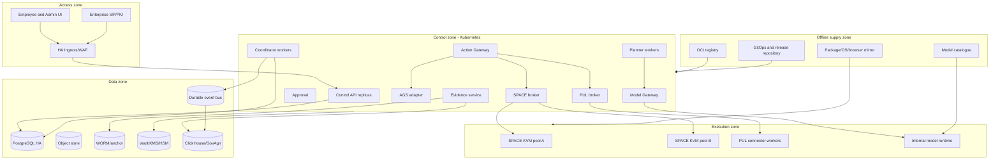

# Enterprise GA Platform, Operations, and Air-Gap Release Specification

## 1. Supported production topology

The primary GA topology is Kubernetes on customer-controlled infrastructure
with dedicated SPACE/KVM worker pools. External managed data services MAY be
used in connected enterprise deployments when approved, but sovereign and
air-gap profiles use customer-operated dependencies.



## 2. Deployment profiles

### 2.1 Evaluation profile

- Single host or small cluster.
- May use local SQLite only for the explicitly labelled developer proof.
- No production data, no external exposure, no HA/SLO claim.
- Docker browser sidecar is permitted only here and labelled non-GA.

### 2.2 Connected enterprise profile

- Customer-controlled identity, keys, data, policy, evidence, and operations.
- Outbound model/connector zones are explicit, allowlisted, and observable.
- Public artifact access is prohibited at runtime; artifacts are promoted to
  internal registries before use.

### 2.3 Sovereign/on-premises profile

- All control/data/execution components remain in approved sovereign regions or
  customer datacentres.
- Customer-managed PKI, KMS/HSM, IdP, registries, backups, monitoring, and SIEM.
- No required vendor-hosted control plane.

### 2.4 Fully air-gapped profile

- No runtime route to public networks or DNS.
- All images, models, packages, software, browser assets, vulnerability data,
  licences, documentation, and updates enter through signed offline bundles.
- Product licence verification, if any, functions offline and has documented
  continuity behaviour.

## 3. Infrastructure requirements

- **OPS-INF-001:** Kubernetes versions, Linux distributions, kernels,
  container runtimes, CPU architectures, storage classes, ingress, and KVM
  hardware MUST be listed in a versioned support matrix.
- **OPS-INF-002:** Production requires at least three failure-domain-aware
  control nodes or a supported managed-equivalent architecture.
- **OPS-INF-003:** SPACE worker nodes MUST be dedicated or strongly isolated,
  expose `/dev/kvm` only to the SPACE broker/runtime, and pass boot-time
  virtualization/network capability checks.
- **OPS-INF-004:** Control, connector, model, execution, data, observability,
  and supply-chain workloads MUST use separate node pools/namespaces and
  default-deny network policies where the platform permits.
- **OPS-INF-005:** Resource requests, limits, priority classes, disruption
  budgets, anti-affinity, topology spread, and autoscaling MUST be defined for
  every workload.
- **OPS-INF-006:** Persistent services MUST use supported HA topologies and
  storage with documented durability, latency, capacity, and failure modes.
- **OPS-INF-007:** All infrastructure and application configuration MUST be
  declarative, schema-validated, reviewed, and exportable for recovery.
- **OPS-INF-008:** Time, DNS, PKI, secret manager, registry, identity, and storage
  dependencies MUST have explicit health/readiness checks and runbooks.

## 4. Availability and SLOs

Initial GA service objectives, subject to customer profile validation:

| Service indicator | Objective |
|---|---|
| Authenticated control API availability | 99.9% monthly |
| Read API p95 latency, excluding export/search | <= 500 ms at reference load |
| Accepted task durability | No acknowledged task loss |
| Action decision p95, excluding human wait | <= 1 second internal policy path |
| Action evidence completeness | 100% of acknowledged effects |
| False successful external effect | 0 tolerated |
| Revocation propagation | <= 5 minutes; emergency stop <= 60 seconds |
| Scheduler start delay p95 | <= 60 seconds under reference load |
| Control-state RPO/RTO | RPO <= 5 minutes, RTO <= 60 minutes |
| Acknowledged evidence RPO | 0 |
| Analytics freshness p95 | <= 5 minutes; not an authorization dependency |

- **OPS-SLO-001:** SLO calculations MUST exclude only documented customer or
  external-provider conditions and MUST still expose those dependencies.
- **OPS-SLO-002:** Error budgets MUST govern release pace for control API,
  task durability, action execution, and evidence independently.
- **OPS-SLO-003:** Evidence loss, false success, tenant breach, or governance
  bypass is a release/incident severity event, not a consumable availability
  error budget.
- **OPS-SLO-004:** Every SLO MUST have metrics, ownership, alert thresholds,
  dashboard, runbook, and monthly report.

## 5. Capacity and admission control

The reference environment MUST publish tested limits for:

- organisations, tenants, users, agents, teams, and connections;
- concurrent interactive tasks, scheduled runs, approvals, and streams;
- actions/second by effect and broker;
- active SPACE computers, startup rate, CPU, memory, storage, and snapshots;
- model concurrency, tokens/minute, context size, and queued requests;
- connector operations, provider rate limits, and result sizes;
- evidence events/second, artifact volume, analytics ingest, and export;
- retention horizon, database size, event backlog, and backup duration.

- **OPS-CAP-001:** Admission MUST occur before model, computer, connector, or
  storage allocation and return a stable queued/throttled/rejected reason.
- **OPS-CAP-002:** Quotas MUST be hierarchical across platform, tenant, team,
  agent, task, schedule, model, connection, and computer profile.
- **OPS-CAP-003:** One tenant's load MUST not exhaust shared workers, event bus,
  database connections, evidence writers, or storage.
- **OPS-CAP-004:** Autoscaling MUST respect external rate, database, model,
  KVM, evidence, and cost limits; scaling is not allowed to violate isolation.
- **OPS-CAP-005:** Degraded dependencies MUST trigger load shedding and clear
  backpressure rather than unbounded queues or memory growth.

## 6. Health, readiness, and diagnostics

- **OPS-HLT-001:** Liveness checks only process deadlock/progress; readiness
  checks required dependencies, migrations, policy/BOM compatibility, identity,
  signing, and ability to serve the component's contract.
- **OPS-HLT-002:** Dependency degradation MUST be component-specific. Analytics
  failure must not mark action execution healthy if evidence is unavailable.
- **OPS-HLT-003:** A preflight command MUST validate CPU/KVM/kernel, storage,
  ports, DNS/NTP/PKI, IdP, secrets, registries, policy, models, SPACE templates,
  PUL connectors, evidence, and capacity.
- **OPS-HLT-004:** A diagnostic bundle MUST collect version/config hashes,
  health, bounded logs, metrics snapshots, queue/lease posture, policy/BOM
  compatibility, and evidence completeness without collecting secrets or
  protected content by default.
- **OPS-HLT-005:** Every degraded state shown to employees or operators MUST
  use a stable reason code and remediation link.

## 7. Observability

- **OPS-OBS-001:** Metrics, logs, traces, task events, action evidence, and audit
  are separate signals with defined retention and loss semantics.
- **OPS-OBS-002:** All signals MUST carry tenant-safe canonical correlation IDs,
  component/build version, environment, and workload identity.
- **OPS-OBS-003:** Logs MUST be structured, bounded, redacted, rate-limited, and
  protected against newline/field injection.
- **OPS-OBS-004:** Trace sampling MAY reduce operational detail but MUST never
  sample authoritative action evidence.
- **OPS-OBS-005:** Alerting MUST cover API/error/latency, queue age, lease loss,
  dead letters, unknown actions, approval age, connector/model/SPACE health,
  capacity, budget, evidence gaps, chain failure, policy/BOM drift, backup, and
  certificate/key expiry.
- **OPS-OBS-006:** Dashboards MUST separate employee workload failure from
  platform failure and external-provider failure.
- **OPS-OBS-007:** Customer SIEM export MUST support documented schemas,
  checkpoints, retries, and data minimization.

## 8. Backup, restore, and disaster recovery

Backup scope:

- PostgreSQL data, roles, schema, and configuration;
- object/artifact storage and manifests;
- evidence ledger, anchors, schemas, and verification keys;
- event bus durable state needed for recovery;
- GovAgn/ClickHouse indexes as rebuildable or backed-up per RTO;
- policy bundles, catalogues, GitOps configuration, release BOM, PKI metadata,
  and wrapped encryption-key material;
- SPACE templates and persistent workspace snapshots where contracted.

- **OPS-DR-001:** Backups MUST be encrypted, immutable, monitored, inventory
  reconciled, and stored in a separate failure/security domain.
- **OPS-DR-002:** Backup credentials MUST be write-only where possible and
  separate from restore credentials.
- **OPS-DR-003:** Restore MUST occur into an isolated recovery environment first
  and verify schema, tenant counts, object manifests, evidence chains/anchors,
  task/action reconciliation, and key accessibility.
- **OPS-DR-004:** Restored in-flight actions MUST enter reconciliation; they are
  never automatically replayed.
- **OPS-DR-005:** Quarterly restore tests and annual full DR exercises MUST meet
  RPO/RTO and produce signed evidence.
- **OPS-DR-006:** Key loss, evidence-anchor loss, regional/datacentre loss,
  malicious deletion, corrupt migration, and supply-chain compromise MUST have
  documented recovery paths.

## 9. Database and event operations

- **OPS-DAT-001:** PostgreSQL MUST use HA replication, automated failover,
  encrypted connections, non-owner application roles, connection pooling,
  query timeouts, and monitored replication/backup lag.
- **OPS-DAT-002:** Migrations MUST be versioned, tested on production-scale
  copies, backward compatible for the declared rollout mode, and separately
  authorized.
- **OPS-DAT-003:** Destructive migrations require an export/rollback plan and
  explicit release gate; automatic down migrations are not assumed safe.
- **OPS-DAT-004:** Event consumers MUST use idempotent inbox/deduplication and
  manual acknowledgement after durable effects.
- **OPS-DAT-005:** Poison events MUST move to a tenant-safe DLQ with schema,
  payload digest, reason, retry controls, and operator evidence.
- **OPS-DAT-006:** Event backlog and outbox growth MUST trigger admission
  control before disks or retention limits are exhausted.

## 10. Installation and configuration

- **REL-INS-001:** The product MUST provide a schema-validated Helm chart that
  deploys every required workload, service account, policy, migration, and
  monitoring rule; helper-only charts are not acceptable.
- **REL-INS-002:** A single-node Compose profile MAY be provided for evaluation
  but MUST not be documented as the HA production topology.
- **REL-INS-003:** Installation MUST be idempotent and support preflight,
  plan/diff, apply, status, verify, and uninstall-with-retention modes.
- **REL-INS-004:** Production installation MUST fail on default credentials,
  missing identity/policy/evidence, unsupported KVM/kernel, untrusted artifacts,
  incompatible BOM, or absent encryption keys.
- **REL-INS-005:** Configuration MUST distinguish secret, immutable, restart,
  rolling, and dynamic fields and reject unknown/misspelled settings.
- **REL-INS-006:** Default production values MUST be secure and least-privileged;
  examples containing weak credentials MUST be impossible to use accidentally.
- **REL-INS-007:** Every successful install MUST produce a signed deployment
  inventory and acceptance result.

## 11. Offline release bundle

Suggested artifact:

```text
agentfabric-enterprise-<version>-<platform>-<classification>.tar.zst
```

Mandatory contents:

- signed release manifest and compatibility BOM;
- OCI archives for all services and infrastructure helpers;
- Helm chart, schemas, evaluation Compose, and GitOps examples;
- database migrations and migration test metadata;
- SPACE kernel/rootfs/templates and governed browser/software images;
- approved model runtime images and optional signed weight/tokenizer layers;
- signed skill/tool/MCP/software/channel catalogues;
- supported thin-client installers;
- SBOMs, provenance, licences, vulnerability/advisory snapshot, checksums;
- offline public verification keys and verification binary;
- preflight/install/status/acceptance/backup/restore/upgrade/rollback/diagnostic
  tools and documentation.

- **AIR-001:** Bundle creation and verification MUST be deterministic and
  scriptable on a disconnected customer staging host.
- **AIR-002:** Import MUST verify outer manifest and each contained artifact;
  partial or extra unmanifested content blocks promotion.
- **AIR-003:** Core operation MUST not require public DNS, package registry,
  image registry, licence server, telemetry endpoint, NTP, or documentation.
- **AIR-004:** All public dependencies needed to build optional customer
  extensions MUST be mirrorable with hashes and licences, or delivered prebuilt.
- **AIR-005:** Vulnerability/advisory updates MUST have a signed offline feed and
  documented staleness status.
- **AIR-006:** Model weights MUST include source, licence/use restrictions,
  immutable digest, format, quantization, tokenizer/config, resource needs, and
  security/evaluation status.
- **AIR-007:** Air-gap acceptance MUST run with outbound network physically or
  administratively blocked and verify no repeated connection attempts.

## 12. Release engineering

- **REL-BLD-001:** Mainline builds MUST run unit, contract, integration,
  migration, lint, static analysis, secret, dependency, licence, image, and
  provenance checks in hermetic or controlled builders.
- **REL-BLD-002:** Release candidates MUST be immutable; retesting a changed
  artifact creates a new candidate/version.
- **REL-BLD-003:** Images and installers MUST support declared architectures and
  be signed after successful release tests.
- **REL-BLD-004:** A release manifest MUST map every component, schema,
  protocol, policy baseline, template, model, client, and verifier to an exact
  digest/version.
- **REL-BLD-005:** Stable, maintenance, and preview channels MUST be distinct;
  production never tracks `latest`, `edge`, or another moving tag.
- **REL-BLD-006:** Release notes MUST include features, fixed defects, security,
  known limitations, breaking/deprecated behaviour, migrations, backup/restore,
  capacity changes, and rollback constraints.
- **REL-BLD-007:** Release signing and promotion require separation of duties and
  immutable approval evidence.

## 13. Upgrade and rollback

Required upgrade flow:

1. Verify bundle signatures, checksums, BOM, licence, hardware, storage, and
   supported source/target versions.
2. Reconcile current configuration, drift, capacity, certificate/key expiry,
   backups, and evidence health.
3. Create and verify backup/restore point.
4. Import artifacts to internal registries and stage GitOps changes.
5. Run additive/preflight migrations.
6. Deploy canary APIs/workers/brokers that cannot claim unsupported work.
7. Run signed smoke/acceptance: login, isolation, deny, approval, PUL read/write,
   SPACE computer/browser action, evidence closure, cost settlement.
8. Promote gradually while monitoring SLO, queues, unknown outcomes, and
   evidence completeness.
9. Finalize irreversible migrations only after rollback window approval.

- **REL-UPG-001:** Supported N-1 upgrade and rollback paths MUST be automated and
  tested; exceptions are documented as downtime migrations.
- **REL-UPG-002:** Database rollback MUST use forward-compatible schema or
  restore/forward-fix plans, not assumed reversible SQL.
- **REL-UPG-003:** Mixed versions MUST be visible and incompatible components
  prevented from serving/claiming work.
- **REL-UPG-004:** Previous signed release artifacts MUST remain locally
  available through the rollback window.
- **REL-UPG-005:** The agent application and planners MUST NOT possess updater
  or release-promotion authority.
- **REL-UPG-006:** Upgrade interruption MUST recover safely without duplicate
  external effects or broken evidence chains.

## 14. Maintenance and support

- **OPS-SUP-001:** Publish support lifecycle, security fix policy, maintenance
  windows, severity definitions, response objectives, and escalation paths.
- **OPS-SUP-002:** Each service/capability MUST have an owning team, on-call,
  dashboard, alerts, runbook, capacity limit, and dependency list.
- **OPS-SUP-003:** Runbooks MUST cover install, upgrade, rollback, backup,
  restore, certificate/key rotation, policy failure, queue backlog, dead letter,
  unknown action, connector/model/SPACE outage, evidence gap, and emergency stop.
- **OPS-SUP-004:** Support access MUST be customer-controlled and work without
  sending sensitive data to a vendor.
- **OPS-SUP-005:** Known limitations MUST be machine-readable where they affect
  preflight or compatibility and visible in documentation/UI.

## 15. Operations acceptance

GA operations sign-off requires:

- two control-plane replicas or more survive single-node/failure-domain loss;
- PostgreSQL failover, event recovery, object/evidence availability, and KVM
  worker loss tests pass;
- reference load meets SLO with documented headroom and admission behaviour;
- backup, isolated restore, full DR, key/certificate rotation, and evidence
  verification meet objectives;
- install, upgrade, rollback, and uninstall/retention pass from signed bundle;
- air-gap edition passes with network disconnected;
- all alerts have actionable runbooks and are exercised;
- support/diagnostic bundles contain no secrets or protected content by default;
- SRE and independent acceptance approve residual operational risks.

