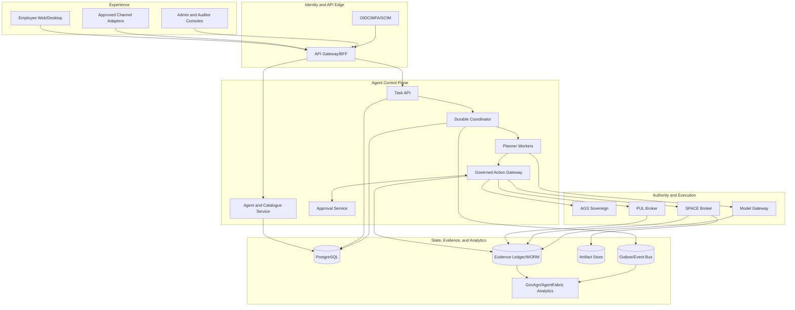

# Enterprise GA System Architecture and Contracts

## 1. Architectural style

The GA system is a modular control plane around an unprivileged agent runtime.
Authority is separated from reasoning, execution, credentials, and evidence.
Components communicate through versioned APIs and durable events; process-local
state is never authoritative for tasks, actions, approvals, or evidence.



## 2. Service specifications

### 2.1 Identity edge and API gateway

Responsibilities:

- terminate authenticated employee/API sessions;
- validate OIDC issuer, audience, nonce, time, MFA/acr, and signature;
- resolve tenant and platform context from trusted membership;
- enforce coarse route-level RBAC/ABAC and rate limits;
- issue short-lived internal workload context, never user-editable tenant
  headers;
- provide BFF endpoints and streaming subscriptions;
- protect against CSRF, XSS token theft, request smuggling, oversized bodies,
  and abusive pagination/search.

Requirements:

- **ARC-IDN-001:** Authentication MUST be enabled in every production profile;
  startup MUST fail when required identity configuration or signing material is
  absent.
- **ARC-IDN-002:** Browser sessions MUST use Secure, HttpOnly, appropriately
  scoped SameSite cookies and anti-CSRF controls for state changes.
- **ARC-IDN-003:** Internal identity context MUST be signed, audience-bound,
  short-lived, and propagated over mTLS.
- **ARC-IDN-004:** The gateway MUST NOT accept caller-selected tenant identity
  except through an explicitly authorized platform-administration operation.
- **ARC-IDN-005:** Authorization MUST be enforced server-side even when the UI
  hides a control.

### 2.2 Agent and catalogue service

Responsibilities:

- own agent definitions, immutable versions, templates, teams, entitlements,
  and lifecycle desired state;
- expose approved model, computer, connection, skill, tool, software, channel,
  memory, schedule, and retention catalogues;
- start durable provisioning/deprovisioning sagas;
- validate cross-catalogue compatibility and policy ceilings.

Requirements:

- **ARC-REG-001:** Catalogue entries MUST be immutable by version and reference
  signed artifact digests where executable content exists.
- **ARC-REG-002:** Catalogue promotion MUST be a separate administrative
  workflow from employee selection.
- **ARC-REG-003:** Agent versions MUST snapshot catalogue references and policy
  ceilings; mutable display metadata MUST be separated from execution truth.
- **ARC-REG-004:** Desired and observed provisioning state MUST be stored
  separately and reconciled.

### 2.3 Task API and durable coordinator

Responsibilities:

- accept idempotent task, input, steer, pause, resume, cancel, and schedule
  commands;
- own task/run/step state machines and leases;
- dispatch planner and action work;
- checkpoint model/tool progress;
- manage retries, approvals, reconciliation, compensation, and dead letters;
- write transactional outbox events with business-state transitions.

Requirements:

- **ARC-COO-001:** PostgreSQL MUST be the source of truth for task state and
  leases in the first GA architecture.
- **ARC-COO-002:** Workers MUST claim work using database-clock leases and
  concurrency-safe row locking such as `FOR UPDATE SKIP LOCKED`.
- **ARC-COO-003:** Every command MUST accept a tenant-scoped idempotency key and
  return the original result for a valid replay.
- **ARC-COO-004:** State transition and outbox event MUST commit atomically.
- **ARC-COO-005:** Lease expiry MUST not imply an external effect is safe to
  repeat; the action record determines retry or reconciliation.
- **ARC-COO-006:** Notifications MAY reduce dispatch latency but MUST NOT be the
  only delivery mechanism.
- **ARC-COO-007:** A bounded worker crash loop MUST move work to a visible dead
  letter state with operator controls.

### 2.4 Planner workers

Responsibilities:

- assemble instructions, conversation, memory, skills, task input, and tool
  schemas;
- call only the Model Gateway;
- emit typed messages, questions, plans, and action proposals;
- evaluate evidence completeness before declaring task completion;
- checkpoint after each durable unit of reasoning or action result.

Requirements:

- **ARC-PLN-001:** Planner workers MUST run without connector, AGS operator,
  SPACE management, database-owner, evidence-signing, or Docker credentials.
- **ARC-PLN-002:** Planner network policy MUST allow only coordinator, Model
  Gateway, approved read-only context services, and Action Gateway endpoints.
- **ARC-PLN-003:** Model output MUST pass structural validation and action
  normalization before becoming executable state.
- **ARC-PLN-004:** Planner loops MUST enforce maximum steps, tokens, elapsed
  time, cost, repeated-action detection, and cancellation checkpoints.
- **ARC-PLN-005:** A planner MUST NOT claim task completion when required action
  receipts or evidence are absent.

### 2.5 Model Gateway

Responsibilities:

- resolve approved model profiles;
- route to internal or explicitly approved providers;
- enforce classification, region, rate, context, budget, timeout, and fallback;
- normalize streaming and usage;
- apply input/output redaction and record invocation evidence;
- expose model health without leaking prompts or credentials.

Requirements:

- **ARC-MDL-001:** Provider credentials MUST remain inside the gateway or its
  secret broker and MUST never be returned to planners.
- **ARC-MDL-002:** Routing MUST be deterministic and evidence the chosen model,
  immutable version/digest, region/runtime, profile, and fallback reason.
- **ARC-MDL-003:** A fallback MUST be policy-equivalent or more restrictive.
- **ARC-MDL-004:** Usage reservation and settlement MUST be idempotent and
  correlated to task/run/invocation IDs.
- **ARC-MDL-005:** Provider error bodies MUST be bounded and redacted before
  storage or return.

### 2.6 Governed Action Gateway

Responsibilities:

- accept typed action proposals from the coordinator/planner only;
- resolve opaque/semantic targets from trusted current state;
- normalize effects and calculate content/action digests;
- enrich classification, destination, identity, entitlement, cost, and risk;
- call AGS and orchestrate human approval;
- obtain and deliver narrow, short-lived capabilities to PUL/SPACE;
- validate receipts, redact results, update durable state, and append evidence;
- reconcile unknown outcomes without blind replay.

Requirements:

- **ARC-ACT-001:** The gateway MUST be the sole supported route to every
  effectful action and sensitive read.
- **ARC-ACT-002:** Action handlers MUST be registered by immutable capability ID
  and version; generic arbitrary HTTP, shell, Docker, or MCP passthrough is
  prohibited.
- **ARC-ACT-003:** Target resolution MUST not trust model-supplied human labels
  when a server-held object/snapshot can resolve the target.
- **ARC-ACT-004:** The normalized action digest MUST bind all security-relevant
  input, including executable content and artifact digests.
- **ARC-ACT-005:** The gateway MUST persist an action record before any policy,
  approval, or execution network call.
- **ARC-ACT-006:** A successful response requires a validated terminal receipt;
  timeouts after dispatch become `unknown`, not `failed` or `success`.
- **ARC-ACT-007:** New action kinds require contract tests, threat-model update,
  policy mapping, receipt schema, evidence mapping, and catalogue admission.

### 2.7 Approval service

Responsibilities:

- store approval requests, resolved action summaries, eligible approvers,
  separation-of-duty rules, decisions, comments, expiry, and reminders;
- consume approvals exactly once through the Action Gateway;
- deliver approval notifications through governed channels.

Requirements:

- **ARC-APR-001:** An approval MUST NOT itself carry execution credentials.
- **ARC-APR-002:** Approval identity MUST use fresh authentication and record
  authentication strength.
- **ARC-APR-003:** The requester MUST NOT approve their own action when policy
  requires separation.
- **ARC-APR-004:** Any digest/context/policy/target change MUST invalidate the
  prior approval.
- **ARC-APR-005:** Approval decisions MUST be immutable; corrections create a
  new superseding record.

### 2.8 AGS adapter

Responsibilities:

- translate canonical action context into the versioned AGS contract;
- validate signed AGS decisions and constraints;
- expose policy bundle status and compatibility;
- fail closed on transport, schema, signature, identity, expiry, or scope error.

Requirements:

- **ARC-AGS-001:** AGS is the only pre-execution PDP. Local code MAY apply
  stricter safety floors but MUST NOT override a deny or required approval.
- **ARC-AGS-002:** Decisions MUST be signed or authenticated, action-bound,
  audience-bound, expiring, nonce-bearing, and revocable.
- **ARC-AGS-003:** Policy shadow mode MUST never disable immutable baseline
  denials.
- **ARC-AGS-004:** Policy version incompatibility MUST block the affected action
  and surface an operator-visible reason.

### 2.9 PUL broker

Responsibilities:

- own provider credentials, delegated users, application identities, token
  refresh/revocation, connector-specific validation, and receipts;
- execute only declared provider operations under action-bound capability;
- return bounded, classified, provenance-bearing results.

Requirements:

- **ARC-PUL-001:** Runtime calls MUST use operation-scoped credentials or
  capabilities; PUL administrator tokens are restricted to provisioning paths.
- **ARC-PUL-002:** Provider redirect, target, object, scope, and tenant checks
  MUST be repeated inside PUL.
- **ARC-PUL-003:** Mutations MUST support a stable idempotency key or expose an
  explicit non-idempotent/unknown reconciliation contract.
- **ARC-PUL-004:** PUL receipts MUST be signed or integrity-protected and bind
  provider, connection, operation, target, action, timing, and outcome.
- **ARC-PUL-005:** Connector workers MUST be isolated by tenant/risk where
  credentials or provider SDKs justify it.

### 2.10 SPACE broker

Responsibilities:

- manage templates, computers, browsers, software layers, networks, execution,
  snapshots, attachments, and teardown;
- verify action-bound capabilities and resource/network constraints;
- return process/browser/file receipts and evidence.

Requirements:

- **ARC-SPC-001:** Only the SPACE broker may hold SPACE management or KVM-level
  authority; its API exposes domain operations, not raw host control.
- **ARC-SPC-002:** Each execution MUST bind tenant, agent, task, run, action,
  template, image/kernel, network, software, resource, and expiry identities.
- **ARC-SPC-003:** Production browser activity MUST use SPACE or an approved
  equivalent isolated broker with the same action/evidence contract.
- **ARC-SPC-004:** Egress MUST be enforced at the network boundary and protect
  against private/link-local/metadata destinations, redirects, and DNS rebinding.
- **ARC-SPC-005:** Cleanup and retention MUST be reconciled after crashes;
  unknown delete outcome MUST not trigger unsafe duplicate provisioning.
- **ARC-SPC-006:** Sandbox escape detection or integrity failure MUST quarantine
  the computer and related agent identity.

### 2.11 Evidence service and GovAgn projection

Responsibilities:

- append authoritative action/evidence records synchronously with acknowledged
  control transitions;
- maintain tenant chains/trees, external anchors, retention, legal hold, and
  verifiable export;
- project evidence and telemetry into GovAgn/AgentFabric search, risk,
  operations, and FinOps views.

Requirements:

- **ARC-EVD-001:** Evidence authority MUST be separate from best-effort
  telemetry/analytics storage.
- **ARC-EVD-002:** Evidence records are append-only; corrections use
  superseding records and never destructive rewrite.
- **ARC-EVD-003:** Evidence MUST be integrity-verifiable across multiple service
  replicas and after backup/restore.
- **ARC-EVD-004:** GovAgn MAY index, enrich, and display evidence but MUST NOT
  become the only copy of authoritative records.
- **ARC-EVD-005:** Evidence append failure before dispatch MUST prevent the
  effect. Failure after possible dispatch MUST mark the action unknown and
  trigger reconciliation.

## 3. State machines

### 3.1 Task state

```text
created -> queued -> planning -> awaiting_policy -> awaiting_approval
                       |               |                 |
                       v               v                 v
                awaiting_input       denied          executing
                       |                                 |
                       +--------------> planning <--------+

executing -> planning | retrying | reconciling | completed | failed | cancelled
any non-terminal -> quarantined
```

Rules:

- **CON-STA-001:** Transitions MUST use optimistic version checks.
- **CON-STA-002:** Terminal states are immutable except for a superseding
  administrative record; a task is never changed from failed to completed.
- **CON-STA-003:** Cancel is an intent until active actions reach a terminal or
  reconciled state.
- **CON-STA-004:** Quarantine dominates normal progress and requires explicit
  authorized release to a new run.

### 3.2 Action state

```text
proposed -> normalized -> deciding
deciding -> denied | awaiting_approval | permitted
awaiting_approval -> denied | expired | revalidating
revalidating -> denied | awaiting_approval | permitted
permitted -> dispatching -> executing
dispatching/executing -> succeeded | failed | unknown
unknown -> reconciling -> succeeded | failed | unresolved
```

Rules:

- **CON-STA-005:** Only `permitted` may enter dispatching.
- **CON-STA-006:** Permit expiry, revocation, or digest mismatch returns to
  deciding; it never executes optimistically.
- **CON-STA-007:** `unknown` is non-terminal until reconciled or explicitly
  closed as unresolved by an authorized operator.
- **CON-STA-008:** Idempotent replay returns the same action/result or continues
  reconciliation; it does not create a second business effect.

### 3.3 Provisioning saga

```text
desired agent persisted
  -> AGS identity
  -> PUL app identity
  -> evidence identity
  -> optional workspace/computer reservation
  -> active
```

Each step has desired/observed state, idempotency key, attempt, next retry,
external ID, receipt, and compensation rule. Deletion reverses entitlements and
credentials before deleting retained content; evidence remains according to
retention/legal hold.

## 4. Canonical contracts

All externally persisted messages use JSON or Protobuf with an explicit schema
name/version, UTC timestamp, canonical IDs, content type, and integrity fields.
Unknown required semantics fail closed. Additive optional fields remain
backward compatible within a major protocol version.

### 4.1 Identity context

```json
{
  "schema": "af.identity-context.v1",
  "organization_id": "uuid",
  "tenant_id": "uuid",
  "subject_id": "uuid",
  "subject_type": "employee|service|schedule|delegate|operator",
  "roles": ["employee"],
  "groups": ["uuid"],
  "authentication": {"method": "oidc", "acr": "...", "time": "..."},
  "session_id": "uuid",
  "issued_at": "...",
  "expires_at": "...",
  "audience": "agent-control-plane"
}
```

### 4.2 Action proposal

```json
{
  "schema": "af.action.v1",
  "organization_id": "uuid",
  "tenant_id": "uuid",
  "employee_id": "uuid",
  "agent_definition_id": "uuid",
  "agent_version": 7,
  "agent_instance_id": "uuid",
  "task_id": "uuid",
  "run_id": "uuid",
  "step_id": "uuid",
  "action_id": "uuid",
  "initiator_type": "person|schedule|webhook|delegate|operator",
  "idempotency_key": "opaque-non-secret",
  "capability": {"id": "browser.activate", "version": "1.0.0"},
  "effect": "read|navigate|type|activate|write|execute|send|delete|administer",
  "target": {"kind": "opaque_ref", "ref": "..."},
  "arguments_ref": "encrypted-object-ref",
  "argument_digest": "sha256:...",
  "content_digests": ["sha256:..."],
  "data_classification": "internal",
  "purpose": "...",
  "requested_scopes": ["..."],
  "network_destinations": ["..."],
  "resource_budget": {"cpu_ms": 0, "memory_mb": 0, "cost_usd": "0.00"},
  "deadline": "...",
  "previous_evidence_hash": "sha256:..."
}
```

### 4.3 AGS decision

```json
{
  "schema": "af.ags-decision.v1",
  "decision_id": "uuid",
  "action_id": "uuid",
  "action_digest": "sha256:...",
  "verdict": "allow|deny|approval_required|handoff_required",
  "policy": {"bundle_id": "...", "version": "...", "digest": "sha256:..."},
  "matched_rules": [{"id": "...", "effect": "deny", "reason_code": "..."}],
  "constraints": {},
  "required_approval": {},
  "nonce": "...",
  "issued_at": "...",
  "expires_at": "...",
  "revocation_ref": "...",
  "signature": "..."
}
```

### 4.4 Execution receipt

```json
{
  "schema": "af.execution-receipt.v1",
  "receipt_id": "uuid",
  "action_id": "uuid",
  "action_digest": "sha256:...",
  "decision_id": "uuid",
  "permit_digest": "sha256:...",
  "executor": {"service_id": "...", "workload_id": "...", "sandbox_id": "..."},
  "runtime_digests": {"image": "sha256:...", "kernel": "sha256:...", "tool": "sha256:..."},
  "resolved_destinations": ["..."],
  "started_at": "...",
  "ended_at": "...",
  "status": "succeeded|failed|unknown",
  "result_code": "...",
  "output_digests": ["sha256:..."],
  "provider_receipts": ["..."],
  "trace_id": "...",
  "evidence_id": "...",
  "signature": "..."
}
```

### 4.5 Evidence event

- **CON-EVD-001:** The canonical event MUST contain schema version, tenant,
  event ID, chain ID, sequence, event type, actor, subject/action references,
  occurred/recorded times, payload digest/reference, previous hash, event hash,
  signer, and signature.
- **CON-EVD-002:** Ordering MUST be deterministic per action chain; cross-chain
  relationships use explicit parent/reference fields rather than one global
  in-memory hash.
- **CON-EVD-003:** Export MUST include schemas, verification instructions,
  anchors, signatures, and referenced artifact manifests.

## 5. External and internal APIs

Minimum public/BFF resources:

```text
/v1/me
/v1/agents
/v1/agent-templates
/v1/tasks
/v1/tasks/{id}/messages
/v1/tasks/{id}/commands/{pause|resume|cancel|steer}
/v1/tasks/{id}/events
/v1/approvals
/v1/connections
/v1/catalogues/{models|computers|skills|tools|software|channels}
/v1/schedules
/v1/evidence
/v1/budgets
/v1/admin/...
```

- **CON-API-001:** All create and command endpoints MUST support idempotency.
- **CON-API-002:** List/search endpoints MUST use bounded cursor pagination and
  server-side tenant filters.
- **CON-API-003:** Streaming MUST authenticate at connect and revalidate on
  token/entitlement expiry; reconnect resumes from a durable cursor.
- **CON-API-004:** Error responses MUST include stable code, safe message,
  correlation ID, retryability, and operator reference without secret leakage.
- **CON-API-005:** OpenAPI/AsyncAPI or Protobuf definitions MUST generate server
  validators and supported clients.
- **CON-API-006:** Breaking changes require a new major protocol version and a
  documented coexistence/migration window.

Internal APIs use separate workload audiences and are not exposed through the
public ingress. Administrative provisioning APIs and runtime execution APIs use
different identities and credentials.

## 6. Data model

Core relational entities:

```text
organizations, tenants, users, groups, memberships
agent_definitions, agent_versions, agent_instances, teams
catalogue_entries, entitlements, connections, schedules
tasks, task_runs, steps, messages, state_transitions
actions, action_attempts, policy_decisions, approvals, capabilities
execution_receipts, artifacts, evidence_records, evidence_anchors
budget_accounts, reservations, usage_settlements, price_versions
outbox_events, inbox_deduplication, worker_leases, dead_letters
retention_policies, legal_holds, deletion_jobs
```

Requirements:

- **DAT-001:** Canonical IDs MUST use one opaque UUID format; tenant IDs are not
  free-form strings.
- **DAT-002:** Every tenant-owned table MUST include tenant ID in primary or
  candidate keys and use forced RLS under a non-owner application role.
- **DAT-003:** Application transactions MUST set tenant context locally and
  MUST clear it automatically on transaction completion.
- **DAT-004:** Cross-tenant platform operations MUST use a separate role and API
  path and MUST emit privileged-access evidence.
- **DAT-005:** Mutable resources MUST use optimistic versions; conflicting
  updates return a conflict rather than last-write-wins.
- **DAT-006:** Secrets MUST be stored as vault references or encrypted envelopes,
  not application plaintext columns.
- **DAT-007:** Large artifacts MUST live in object storage with database
  metadata, digest, classification, owner, retention, encryption key reference,
  and scan status.
- **DAT-008:** Deletion MUST be asynchronous, idempotent, legal-hold aware, and
  produce verifiable tombstone/completion evidence.
- **DAT-009:** Price catalogue entries MUST be effective-dated and immutable;
  usage settlement records the exact version used.
- **DAT-010:** Schema migration ownership MUST be separate from runtime access;
  runtime identities cannot alter schema.

## 7. Consistency and delivery semantics

- User/control state: strongly consistent transaction in PostgreSQL.
- Task dispatch: at-least-once delivery with idempotent consumers.
- External effects: exactly-once business intent through idempotency and
  reconciliation; transport itself may be at least once.
- Evidence: append before dispatch and append outcome after execution;
  acknowledgement requires durable commit.
- Telemetry/analytics: asynchronous and may be sampled, but loss is visible and
  never changes evidence truth.
- Live UI: eventual projection with durable resume cursor; UI state does not
  authorize actions.

## 8. Failure semantics

| Failure point | Required behaviour |
|---|---|
| Before action persisted | No effect; caller may retry with same key |
| After action persisted, before AGS | Resume decision safely |
| AGS timeout/malformed decision | Fail closed; retry boundedly |
| Approval notification failure | Request remains durable; retry delivery |
| After approval, before dispatch | Revalidate policy/target; safe resume |
| Dispatch timeout before executor acknowledgement | Mark unknown; query/reconcile by idempotency key |
| Executor reports terminal failure | Persist receipt/evidence; apply declared retry policy |
| Evidence append unavailable before dispatch | Do not dispatch |
| Evidence append unavailable after possible effect | Mark unknown/quarantine path; reconcile |
| Worker dies with lease | Replacement recovers after lease; no blind effect replay |
| Database primary failover | Clients retry transactions; leases use database clock |
| Event bus unavailable | Outbox accumulates; business transaction may continue within capacity guard |
| Analytics unavailable | Evidence/control continues; lag is alerted |
| Revocation during execution | Block next capability; cancel/terminate current execution where supported |

## 9. Compatibility and versioning

- **CON-VER-001:** Every component MUST publish product version, protocol
  versions, schema migration range, build digest, and compatibility BOM ID.
- **CON-VER-002:** The installer MUST reject combinations outside the signed BOM.
- **CON-VER-003:** N and N-1 rolling compatibility MUST be defined for APIs,
  events, workers, clients, AGS, PUL, SPACE, and GovAgn, or the release MUST use
  an explicit downtime upgrade.
- **CON-VER-004:** Old workers MUST not claim new unsupported work; capability
  negotiation is server-enforced.
- **CON-VER-005:** Evidence schemas remain verifiable indefinitely and ship with
  archived schema definitions and verification tooling.

## 10. Repository and code boundaries

Target logical layout:

```text
apps/
  employee-web/ admin-console/ control-api/ coordinator-worker/
packages/
  contracts/ domain/ persistence/ sdk/ testkit/
  model-adapters/ channel-adapters/
brokers/
  action-gateway/ model-gateway/ pul-broker/ space-broker/
services/
  ags-adapter/ evidence-service/ govagn-adapter/
infra/
  compose/ helm/ migrations/ airgap/ installer/ updater/ backup/
```

The layout may be implemented incrementally. Boundaries are contractual even
when two modules initially share one deployable. Privileged brokers and planner
workers must be separate processes and workload identities from their first GA
implementation.

## 11. Architecture acceptance

The architecture is acceptable for GA when:

- supported effect paths cannot bypass the Action Gateway;
- planner compromise does not yield credentials or execution-management power;
- all task/action state recovers across worker and node replacement;
- schema and protocol compatibility is automatically checked;
- tenant isolation holds at API, database, cache, event, object, search,
  telemetry, and evidence layers;
- every acknowledged action produces a verifiable receipt/evidence chain;
- independently deployed AGS, PUL, SPACE, and GovAgn versions match a signed BOM;
- the deployment contains no production dependency on archived code or the
  local SQLite/inline-UI runtime.

